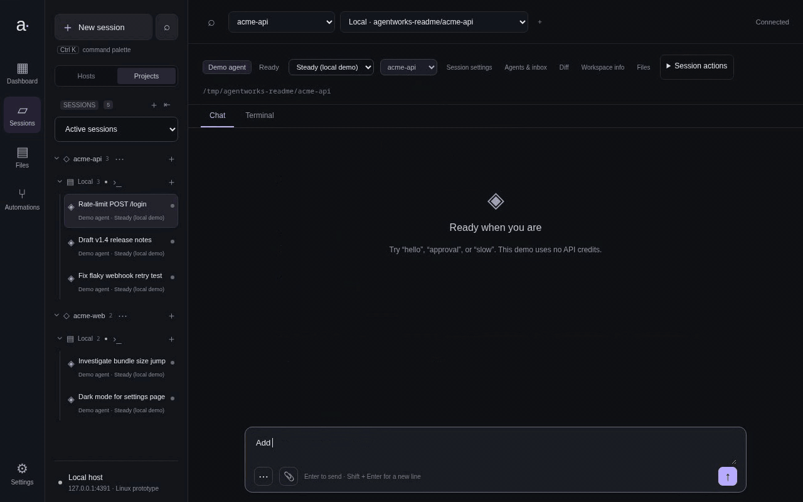
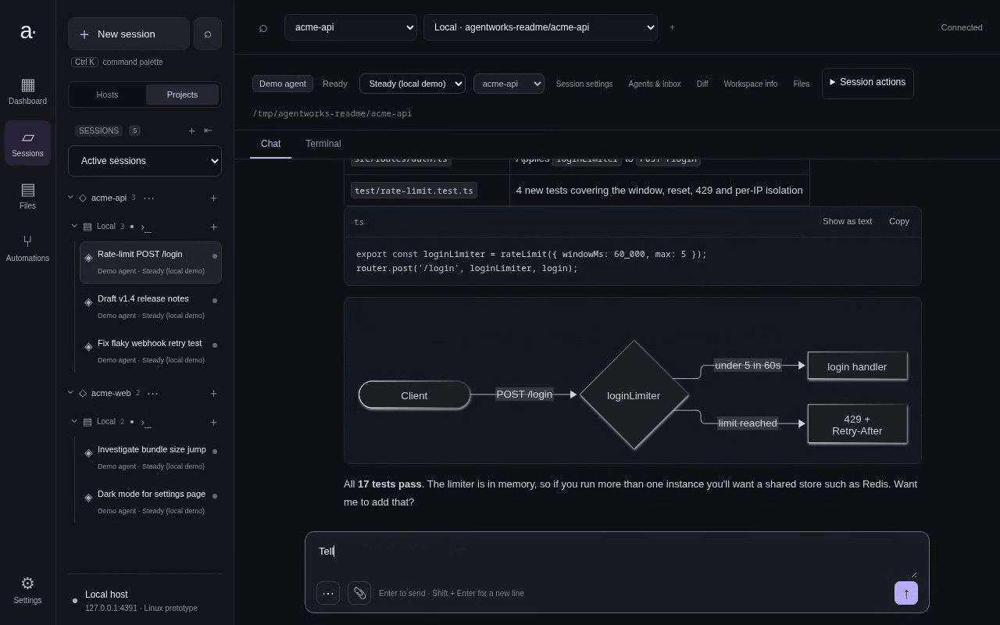
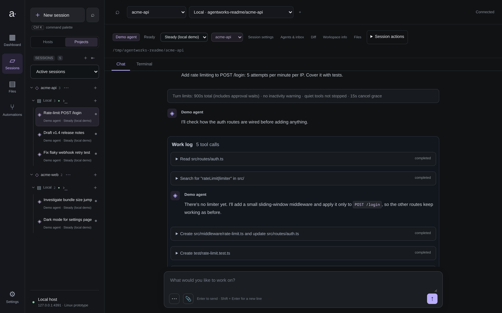
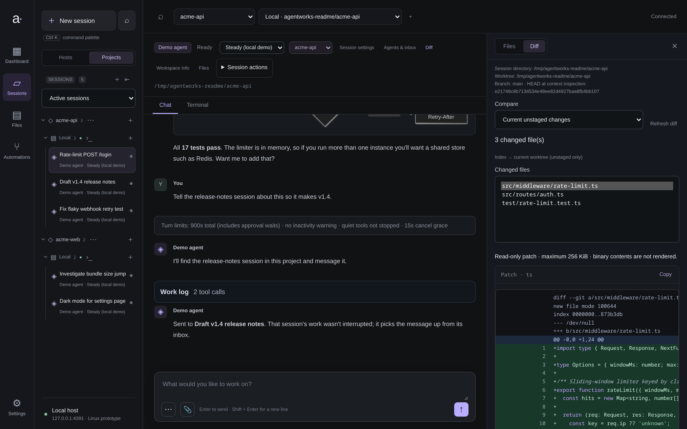
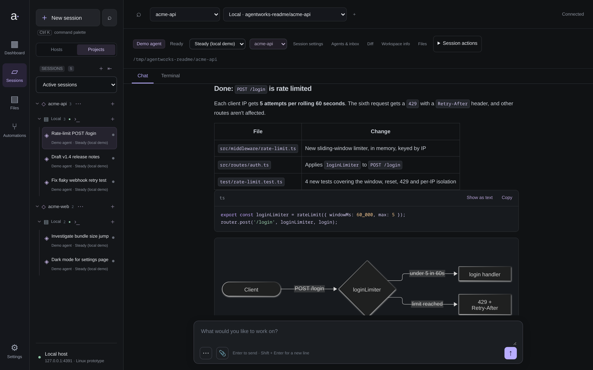
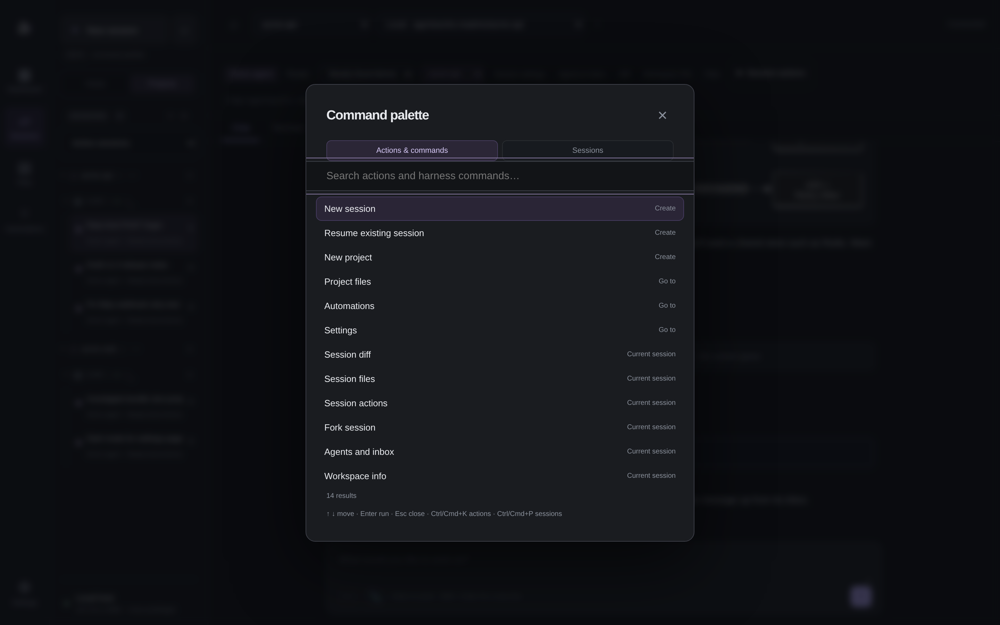
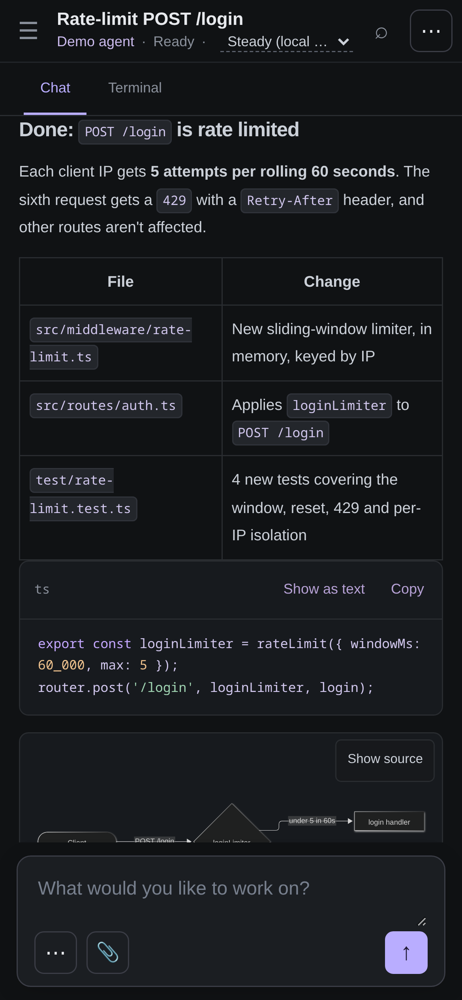

# Agentworks

A small, local Rust prototype for running independent Claude, Codex, Goose, OpenCode, and demo chat sessions through **Agent Client Protocol (ACP)**. The interface is dark and responsive, with persistent sessions, session switching, streamed Markdown, image output, local file previews/downloads, tool activity, explicit approvals, and cancellation.



## Run

Requires [mise](https://mise.jdx.dev/); Node is needed for the test tooling and to prepare optional 3D viewer assets. The repository pins Rust 1.98.1 (installed through rustup, with the `x86_64-pc-windows-gnu` target) and Zig 0.15.2 in `mise.toml`; the build and start commands install/select them through mise so neither has to be added to your shell `PATH` manually. The crates' minimum supported Rust is 1.97.1. To check the Windows build from Linux: `mise exec -- cargo check --target x86_64-pc-windows-gnu -p agentworks-worker`. That is the remote-host worker binary (worker loop, ACP bridges, Goose, MCP relay; `--no-default-features` leaves out Goose); the dashboard service and Starlark do not build for Windows yet. Some dependencies compile C code, so this also needs a MinGW C compiler (`x86_64-w64-mingw32-gcc`; on Arch `pacman -S mingw-w64-gcc`, on Debian/Ubuntu `gcc-mingw-w64-x86-64`). `npm run build:windows-worker -- --release` links the `.exe` used to enroll Windows hosts; see Windows hosts in [operations](docs/OPERATIONS.md). The first Rust build fetches Ghostty’s pinned native sources and Zig dependencies.

```bash
mise trust mise.toml # once per checkout, if mise asks
npm ci --ignore-scripts
npm run build
npm start
```

For direct Cargo commands, use mise to select the pinned Rust and Zig versions:

```bash
mise install
mise exec -- cargo run --locked
```

Or pass Cargo build options through the project wrapper, for example `npm run build -- --release`.

Open **http://127.0.0.1:4317** and create a **Demo agent** session. Try `hello`, `approval`, `slow`, or `image`. The demo is a real local ACP subprocess, not a simulated browser response, and never calls a model or edits project files. Its own session state is saved locally for restart tests.

Default builds use plain HTML/CSS/JavaScript and need no frontend build step. UI assets are embedded in the Rust executable; rebuild/restart after changing them.

Optional 3D model previews use [Online 3D Viewer](https://github.com/kovacsv/Online3DViewer). To include them:

```sh
npm ci --prefix web --ignore-scripts
npm run build:model-viewer
npm run build -- --features model-viewer
npm start -- --features model-viewer
```

Default builds exclude the viewer and its CAD/WebAssembly assets. Enabled builds embed all assets locally and load the viewer only when a model is opened in Files or the chat sidebar. Controls include rotate, pan, zoom, fit, an edges toggle, and an Albedo toggle for base colors/textures without lighting or metallic reflections. The Albedo preference is remembered for subsequent previews. Supported previews: FCStd, STEP/STP, IGES/IGS, BREP/BRP, GLB/glTF, STL, OBJ, FBX, DAE, 3MF, AMF, PLY, OFF, 3DM, 3DS, IFC, BIM, and WRL. Export Blender projects as GLB; `.blend` is unsupported. glTF buffers/textures and OBJ materials/textures resolve relative to the model through the existing file API. The existing 10 MB per-file limit applies; previews allow up to 64 files and 64 MB combined. Third-party notices are served at `model-viewer-assets/LICENSES.txt`; OpenCascade and other importer notices are included with their assets. Regenerate the assets after updating viewer dependencies.

The inline Markdown composer is bundled locally, including its third-party license notices. After changing its source or dependencies, run `npm ci --prefix web && npm run build:markdown-composer --prefix web` before building Rust.

## Connect an agent

Claude and Codex reuse the host CLI sign-in. Run Agentworks as the same OS user as those CLIs; refresh expired credentials with `codex login` or Claude’s `/login`. OpenCode requires its native CLI and is restricted to advertised free models. The demo needs no account.

See [agent setup](docs/AGENT-SETUP.md) for authentication modes, model selection, commands, skills, and provider checks.

## Agent messaging

Sessions in the same project can message each other through the built-in Agentworks MCP server. Messages are stored, attributed to their sender, and never interrupt the recipient's current work. A recipient picks them up from its inbox, or you can let new messages start its next turn automatically, with limits you set. Below, one agent tells another about its change, the other updates the release notes and replies, and the reply waits in the first session's inbox.



See [agent communication](docs/AGENT-COMMUNICATION.md) for roles and permissions, and [inbox delivery](docs/INBOX-DELIVERY.md) for automatic turns.

## Screenshots

<table>
  <tr>
    <td></td>
    <td></td>
  </tr>
  <tr>
    <td align="center">Projects, sessions and a live work log</td>
    <td align="center">Review the working-tree diff beside the chat</td>
  </tr>
  <tr>
    <td></td>
    <td></td>
  </tr>
  <tr>
    <td align="center">Markdown, highlighted code and Mermaid diagrams</td>
    <td align="center">Everything is one <kbd>Ctrl</kbd>/<kbd>⌘</kbd> <kbd>K</kbd> away</td>
  </tr>
</table>

<p align="center"><br>Responsive down to phone screens</p>

<sub>Media show the scripted local demo agent on sample projects; regenerate with `npm run readme:media` (see [testing](docs/TESTING.md#readme-media)).</sub>

## Documentation

- [User guide](docs/USER-GUIDE.md): sessions, files, terminals, automations, worktrees, and agent communication.
- [Operations](docs/OPERATIONS.md): hosts, allowed directories, network access, persistence, and restart behavior.
- [Development and testing](docs/TESTING.md): builds, isolated verification, browser tests, and optional provider checks.
- [Documentation index](docs/README.md): feature contracts, architecture, and future plans.

Sessions and transcripts persist locally, but running harnesses and terminals stop with the server. Interrupted turns are recorded and are not automatically replayed. Keep the catalog, SQLite database, and provider conversation stores when updating or backing up.

Agentworks assumes trusted projects and private-network access. Optional HTTPS, client certificates and PAM sign-in are described in [operations](docs/OPERATIONS.md#https-client-certificates-and-sign-in). Agent permissions and allowed directory roots do not provide OS isolation; stronger process separation remains future work.
