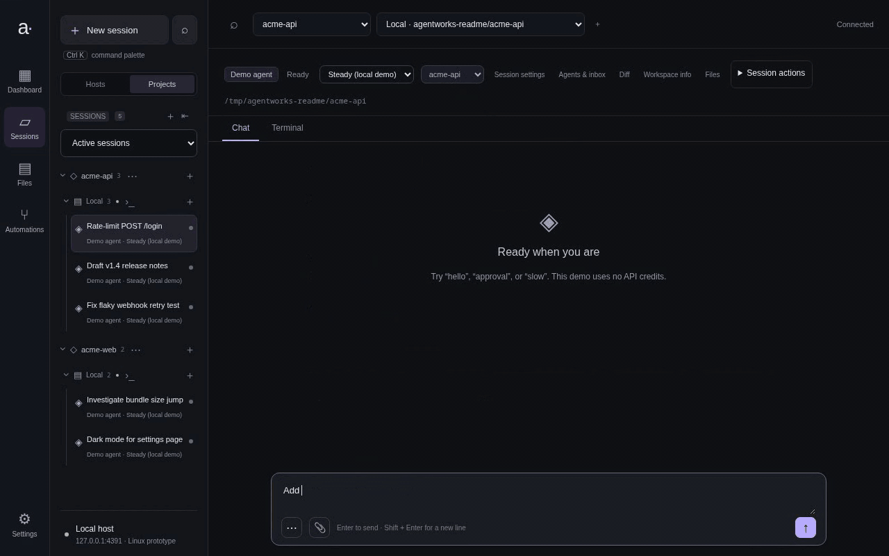
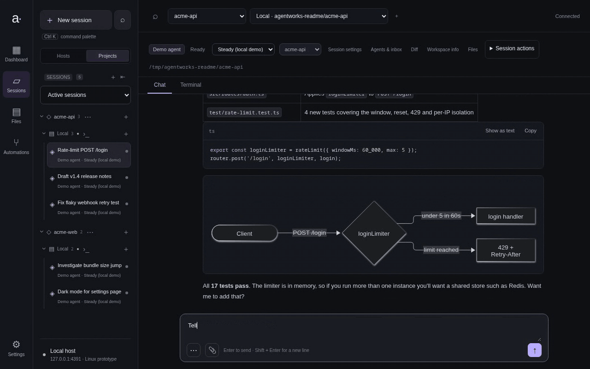
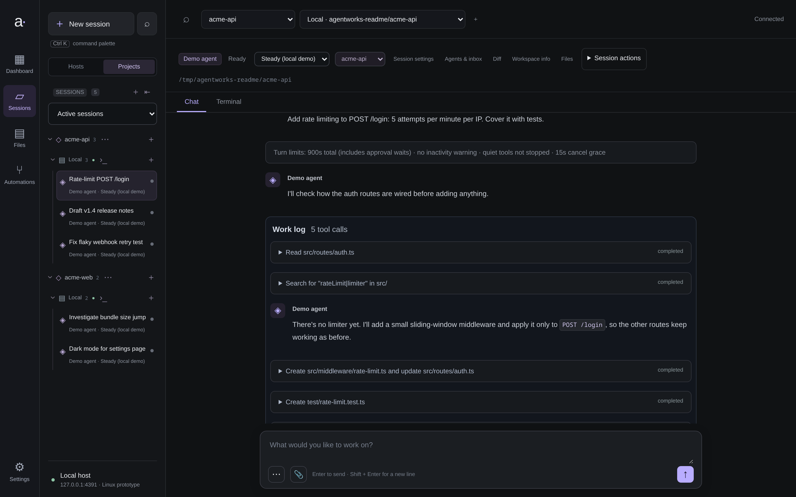
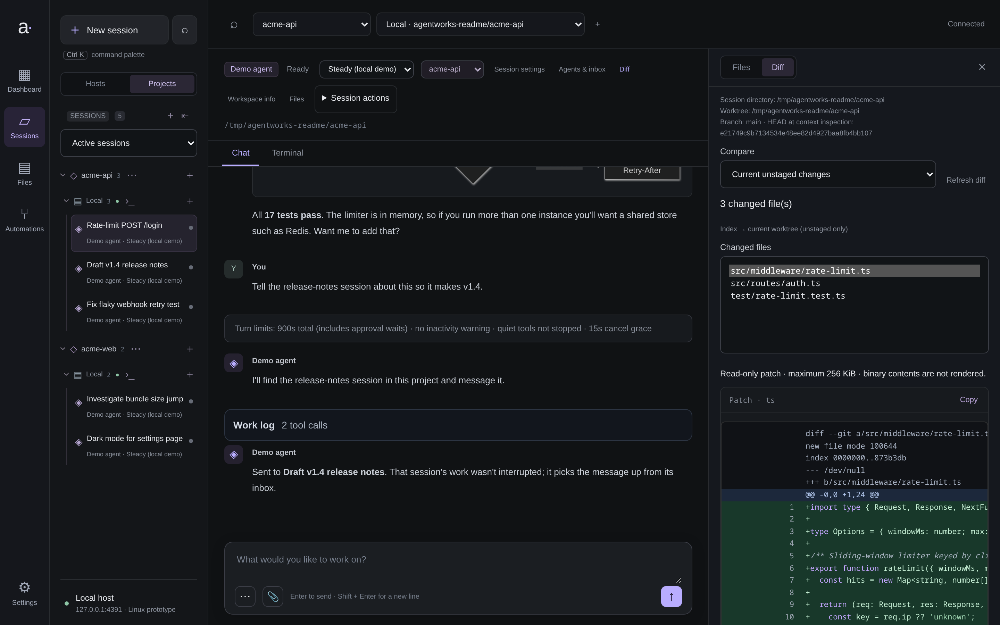
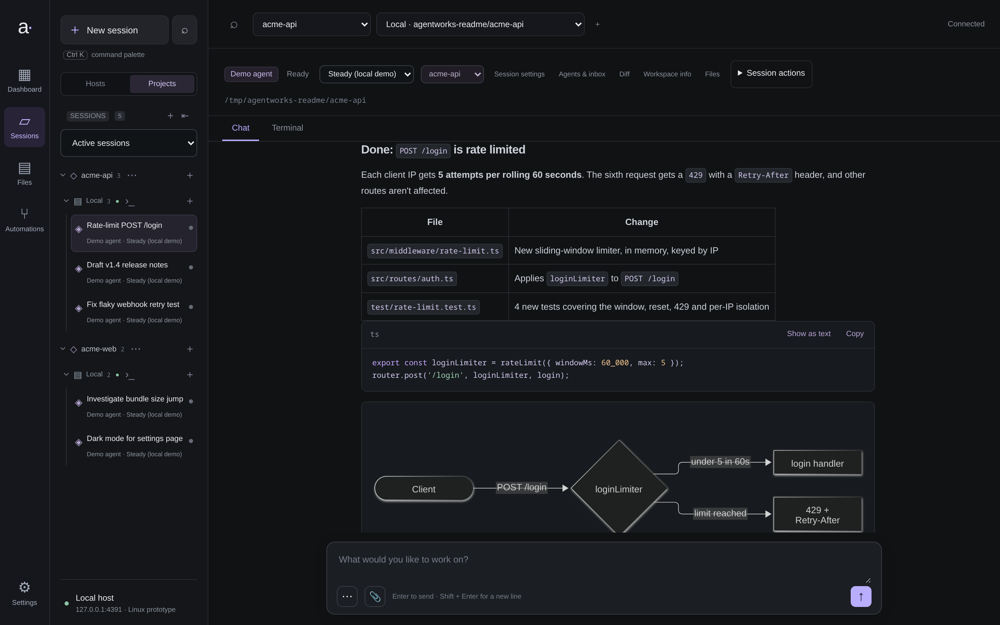
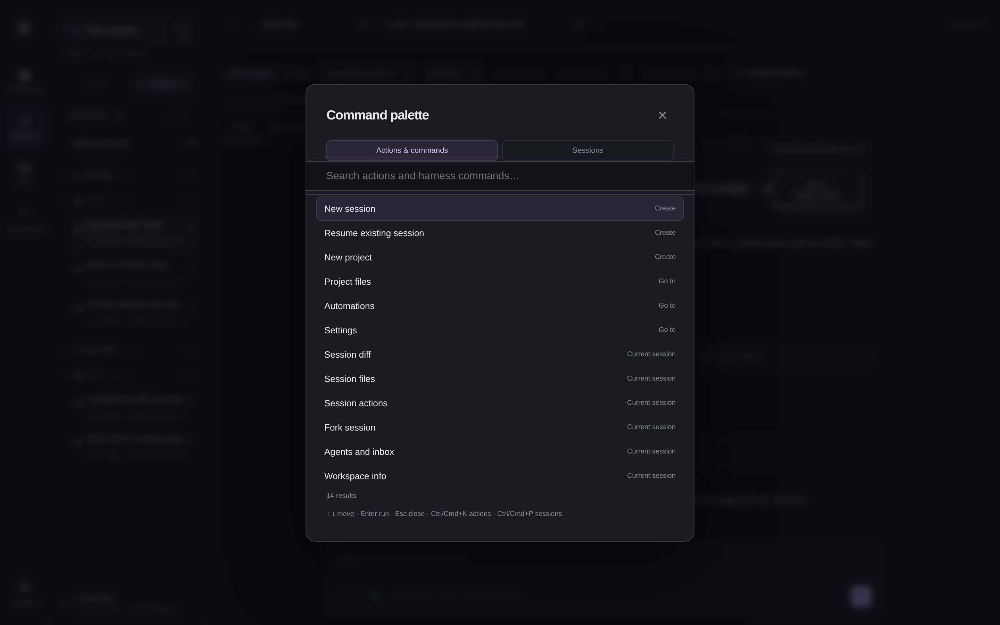
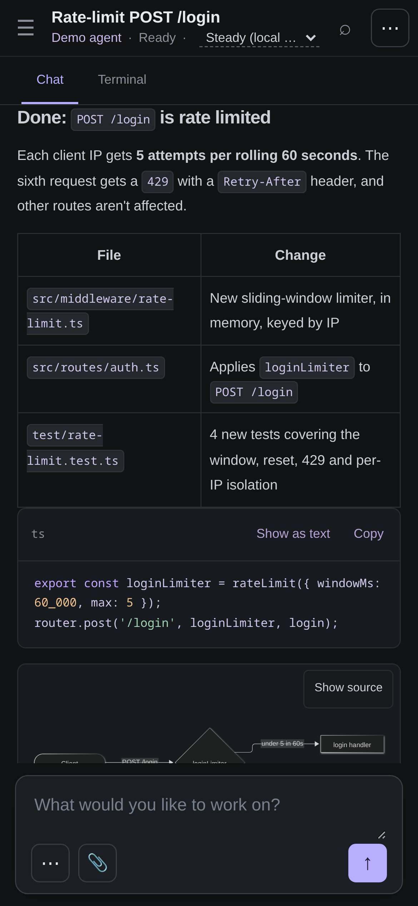

# Agentworks

A small, local Rust prototype for running independent Claude, Codex, Goose, OpenCode, and demo chat sessions through **Agent Client Protocol (ACP)**. The interface is dark and responsive, with persistent sessions, session switching, streamed Markdown, image output, local file previews/downloads, tool activity, explicit approvals, and cancellation.



## Run

Requires [mise](https://mise.jdx.dev/) and Node (use a current LTS supported by the adapters). The repository pins Rust 1.98.1 (installed through rustup, with the `x86_64-pc-windows-gnu` target) and Zig 0.15.2 in `mise.toml`; the build and start commands install/select them through mise so neither has to be added to your shell `PATH` manually. The crates' minimum supported Rust is 1.94.1. To check the Windows build from Linux: `mise exec -- cargo check --target x86_64-pc-windows-gnu -p agentworks-terminal` (other crates do not build for Windows yet). The first Rust build fetches Ghostty’s pinned native sources and Zig dependencies.

```bash
mise trust mise.toml # once per checkout, if mise asks
npm ci --ignore-scripts
npm run build
npm start
```

For direct Cargo commands, use mise to select the pinned Rust and Zig versions:

```bash
mise install
mise exec -- cargo run --locked
```

Or pass Cargo build options through the project wrapper, for example `npm run build -- --release`.

Open **http://127.0.0.1:4317** and create a **Demo agent** session. Try `hello`, `approval`, `slow`, or `image`. The demo is a real local ACP subprocess, not a simulated browser response, and never calls a model or edits project files. Its own session state is saved locally for restart tests.

The prototype uses plain HTML/CSS/JavaScript so there is no frontend build step. UI assets are embedded in the Rust executable; rebuild/restart after changing them.

## Connect an agent

Claude and Codex reuse the host CLI sign-in. Run Agentworks as the same OS user as those CLIs; refresh expired credentials with `codex login` or Claude’s `/login`. OpenCode requires its native CLI and is restricted to advertised free models. The demo needs no account.

See [agent setup](docs/AGENT-SETUP.md) for authentication modes, model selection, commands, skills, and provider checks.

## Agent messaging

Sessions in the same project can message each other through the built-in Agentworks MCP server. Messages are stored, attributed to their sender, and never interrupt the recipient's current work. A recipient picks them up from its inbox, or you can let new messages start its next turn automatically, with limits you set. Below, one agent tells another about its change, the other updates the release notes and replies, and the reply waits in the first session's inbox.



See [agent communication](docs/AGENT-COMMUNICATION.md) for roles and permissions, and [inbox delivery](docs/INBOX-DELIVERY.md) for automatic turns.

## Screenshots

<table>
  <tr>
    <td></td>
    <td></td>
  </tr>
  <tr>
    <td align="center">Projects, sessions and a live work log</td>
    <td align="center">Review the working-tree diff beside the chat</td>
  </tr>
  <tr>
    <td></td>
    <td></td>
  </tr>
  <tr>
    <td align="center">Markdown, highlighted code and Mermaid diagrams</td>
    <td align="center">Everything is one <kbd>Ctrl</kbd>/<kbd>⌘</kbd> <kbd>K</kbd> away</td>
  </tr>
</table>

<p align="center"><br>Responsive down to phone screens</p>

<sub>Media show the scripted local demo agent on sample projects; regenerate with `npm run readme:media` (see [testing](docs/TESTING.md#readme-media)).</sub>

## Documentation

- [User guide](docs/USER-GUIDE.md): sessions, files, terminals, automations, worktrees, and agent communication.
- [Operations](docs/OPERATIONS.md): hosts, allowed directories, network access, persistence, and restart behavior.
- [Development and testing](docs/TESTING.md): builds, isolated verification, browser tests, and optional provider checks.
- [Documentation index](docs/README.md): feature contracts, architecture, and future plans.

Sessions and transcripts persist locally, but running harnesses and terminals stop with the server. Interrupted turns are recorded and are not automatically replayed. Keep the catalog, SQLite database, and provider conversation stores when updating or backing up.

Agentworks assumes trusted projects and private-network access. Agent permissions and allowed directory roots do not provide OS isolation; application login and stronger process separation remain future work.
