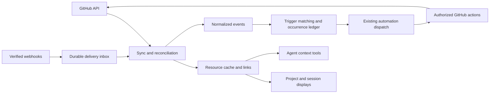

# GitHub integration proposal

Status: design proposal. The first context implementation is documented in [GitHub context](GITHUB.md); triggers and typed GitHub actions below remain proposed.

## Product direction

Make GitHub a shared source of project context. The same repository, pull request, issue, check and review information should be usable in the interface, agent tools and automation conditions. Changes should be traceable from GitHub through an automation occurrence to an Agentworks session and any resulting GitHub action.

Useful initial experiences:

| Surface | Experience |
| --- | --- |
| Project overview | Repository links, open PRs, failing workflows and saved issue/PR views |
| Session header | Linked issue/PR, draft/merged state, checks, review status and freshness |
| Git/diff panel | PR base/head, changed files, review threads and checks for the displayed commit |
| Conversation | Explicitly attached GitHub context, compact link previews and actions to start work from an issue |
| Automations | Select GitHub events or state transitions, filter them, preview matches and inspect dispatch history |
| Work history | Navigate issue → sessions → commits → PR → checks/reviews; see why each run started |

Display data independently from whether an automation is enabled. Loading a page must never arm a trigger. Scope saved views to a connection and repository set; showing a result does not authorize an agent to act on it.

## Shared model and extension points

Use a small set of explicit contracts:

- **Connection:** provider, GitHub host, account/installation, credential reference, effective capabilities and health. A project can bind several repositories and connections. Public and Enterprise GitHub hosts are part of identity from the first release. All credential sources are on the main Agentworks host.
- **Resource reference:** host + immutable repository ID + resource kind + provider ID. Preserve names, numbers and URLs for display; do not make repository names the durable identity. Check/workflow records also carry commit SHA and run attempt.
- **Link:** a project/session relationship to a repository, issue, PR or commit, with origin (`explicit`, `automation`, `inferred`) and optional primary designation. Multiple issues, PRs and sessions can be related.
- **Resource snapshot:** normalized fields, provider-specific details, source version where available, fetched time, completeness and access state. Unknown, pending, stale and denied are distinct from false or empty.
- **Event:** schema version, connection, repository/resource reference, kind/action, delivery or observation identity, actor, timestamps, source (`webhook` or `poll`) and relevant commit/run identity. Keep event-time facts separate from current snapshots.
- **Capability descriptors:** supported resource queries, events, condition fields and typed actions, including required permissions. UI, validation and agent tools consume the same descriptors.

Start with built-in Rust modules and versioned schemas. Add resource kinds and event descriptors without changing every screen. Share integration plumbing where useful, while retaining GitHub concepts such as check suites and review threads. A dynamic plugin loader and a universal workflow language are unnecessary for the first release.

Cache keys and reads must respect connection/access boundaries. The literal hostname in local or remote repository `origin` selects main-host connections. A unique account is saved automatically; multiple accounts require a saved explicit choice. Worktrees share repository bindings. SSH alias resolution is deferred. Match PRs by repository, head repository and branch, then confirm against SHA. Never silently select the first PR with a matching branch name.

## Trigger semantics

Offer two explicit modes:

1. **Event:** “A review was submitted” or “An issue received label `agent-ready`.” Event-time actor/action facts are preserved even if current state has changed.
2. **State transition:** “This PR became ready for review” or “Required checks became successful for this head SHA.” Compute a condition over a sufficiently fresh snapshot and fire when it changes from false to true. Unknown does not satisfy it.

Examples worth supporting:

| Trigger | Conditions | Result |
| --- | --- | --- |
| Issue labeled | Allowed repository, label `agent-ready`, trusted actor | Start an implementation session with the issue attached |
| PR ready for review | Non-draft, selected base branch, allowed author | Start a review session pinned to its head SHA |
| Workflow attempt failed | Selected workflow, current PR head | Start a diagnostic session with run/check links |
| Changes requested | Linked PR, selected reviewer policy | Queue context for its existing session, or start a follow-up session |
| PR became merge-ready | Required checks and review policy satisfied | Notify the user; a separate authorized action can merge |

“Merge-ready” requires actual repository rules and review/check evaluation. It must not mean only that the visible checks are green. Treat incomplete evaluation as unknown and defer this trigger until the necessary rule support exists.

The automation editor should read naturally: **When → In repositories → If → Do**, followed by delivery and concurrency policy. Provide a dry run against stored examples, showing each matched or rejected condition, the context to attach, and the permissions required. Simulation never dispatches work or writes to GitHub.

For the first event release, support issue-label events, PR opened/ready-for-review events and workflow-attempt failures. Describe polling limitations per event: snapshot comparison can detect a label becoming present, but cannot promise every add/remove operation or its actor between polls. Disable exact actor/action filters when that provenance is unavailable. State transitions need their own observed-transition identity; webhook delivery IDs alone cannot deduplicate webhook and polling observations of the same transition.

On enable/resume, establish a baseline without firing on existing matches. Historical backfill is an explicit operation with a preview. For a state transition, once true stays quiet until the condition becomes false and later true again. Conditions about checks/reviews are evaluated for a specific head SHA; a new commit creates a new evaluation scope.

## Reliable ingestion and dispatch

Webhooks supply timely change signals; API reconciliation supplies current state and repairs detectable gaps. A webhook should not overwrite a newer snapshot blindly. Serialize refreshes per resource or use version checks, and refetch when ordering cannot be established.

1. Verify webhook signature over the raw body, validate connection/repository scope and enforce payload limits.
2. Persist the accepted delivery with a uniqueness key scoped to its source connection. Return success after durable receipt; normalize and enrich asynchronously.
3. Update resources and write normalized events plus evaluation work atomically where possible. Use durable jobs/outbox records across transaction boundaries.
4. Match enabled trigger revisions and record the decision, including filtered, duplicate, deferred or skipped outcomes.
5. Claim a durable occurrence and dispatch through the existing automation start path. Use a bounded stable request ID derived from automation revision and semantic occurrence identity. Recovery must reuse that ID.

Persist connection/binding state, sync checkpoints, delivery inbox, snapshots, events, trigger evaluations/occurrences and action attempts. Retain enough deduplication evidence beyond payload pruning to prevent retained events from being replayed accidentally. Restrict raw payload retention because it may contain private repository content.

Existing scheduled automations allow one active run per definition and record busy occurrences as skipped. Preserve that default initially and expose it clearly. A later queue policy can keep a bounded pending occurrence per resource, coalesce superseded CI failures and recheck current applicability before dispatch. Do not silently add concurrent sessions per PR; that changes the current contract.

Keep ingestion running during a service drain where feasible, but defer starting work. Record unavailable hosts, revoked credentials, paused definitions, busy runs and exhausted budgets distinctly. Retry transient transport/enrichment failures with bounds and backoff; never repeatedly replay an interrupted agent turn. Recheck author grants and connection/repository authority at dispatch time.

GitHub actions and agent turns can themselves cause more events. Record action provenance, ignore self-generated events by default where identifiable, and apply cooldowns, run budgets and maximum follow-up counts. Bot-only filtering is insufficient because user-attributed writes can also be automated.

Every run should show: source link, observed event, matched conditions, automation revision, source freshness, attached snapshot and dispatch disposition. Explicit replay creates an audited new attempt; delivery redelivery does not.

## Authentication and deployment

Prefer GitHub App installations for sustained repository automation, using explicit repository selection and capability-based permissions. Keep authorization for user-attributed actions distinct from installation/bot actions. Connections should reveal the effective identity and unsupported capabilities before a workflow is saved.

For a local-first entry point, support an explicitly selected existing `gh` identity or a fine-grained token via a credential reference. Do not silently choose a different host account or treat a CLI login as permission to monitor every accessible repository. A CLI credential adapter is a bootstrap option; normalize its results behind the same provider interface.

Keep secrets server-side, outside transcripts and API responses. Reference the credential subsystem rather than duplicating its storage. The GitHub credential connection should be a separable dependency if credential management evolves independently.

Two transport modes use the same downstream model:

- **Local/private server:** bounded authenticated polling, conditional requests, shared scheduling across subscribers and visible last-sync age. No inbound public endpoint required. Show which events cannot be observed exactly.
- **Reachable server:** signed webhooks plus periodic reconciliation. A future relay is an explicit deployment feature with its own trust and retention contract, not an assumed dependency.

Run all integration API access and credential resolution centrally; never invoke `gh` or inspect GitHub credentials/configuration on remote hosts. Remote workers supply origin, branch and SHA only; remote workers need source context and repository access for their own Git operations, not a copy of the integration credential. Revocation disables reads/actions and pending dispatch, invalidates usable caches for that connection, and leaves an appropriately restricted audit record. Never convert an access-denied response into “the PR was deleted.”

GitHub recommends webhooks where possible, efficient conditional polling when necessary, and respecting API backoff headers: [REST API best practices](https://docs.github.com/en/rest/using-the-rest-api/best-practices-for-using-the-rest-api). Its webhook guidance covers signatures, prompt acknowledgment and stable delivery IDs across redelivery: [webhook best practices](https://docs.github.com/en/webhooks/using-webhooks/best-practices-for-using-webhooks). Repository access and API permissions depend on the installation: [installation authentication](https://docs.github.com/en/apps/creating-github-apps/authenticating-with-a-github-app/authenticating-as-a-github-app-installation).

## Actions and agent context

Read operations should include resource lookup, repository-scoped search, current checks/reviews and fetching selected details. Let users attach context deliberately, and expose bounded structured tools for an agent to refresh it. Record a context snapshot for the run while labeling a later refresh as current data.

Treat issue bodies, comments, filenames and logs as external content, never as authority to change grants or instructions. Trigger configuration determines the task; an untrusted comment cannot grant itself permission to start or control a session. Actor trust rules are explicit, especially for public repositories.

Later typed actions can post/update comments, change labels, request reviews, create draft PRs, rerun workflows and merge. Each declares required scope, target, actor identity, preconditions, confirmation policy and retry behavior. Recheck the head SHA and other relevant preconditions before executing a stale plan.

The current automation `Step` only contains agent instructions compiled into one prompt; it does not durably execute native actions or wait for GitHub conditions. Keep the first release within that model. Typed actions and waits require an explicit runtime extension, or a separately approved adoption of the experimental workflow host. Writing “then merge” in a prompt is not a durable action contract.

GitHub does not offer a universal exactly-once write primitive. Use an action ledger and operation-specific reconciliation: an uncertain comment creation must be reconciled before retrying, while a label-set operation may be naturally repeatable. Surface an unknown outcome when safe reconciliation is unavailable. Keep ordinary merge actions separate from permission to bypass protection rules.

## Fit with this repository and delivery sequence

The [automation implementation](../crates/agentworks/src/automations.rs) currently supports manual, weekly and one-time triggers, and agent-only steps. [Scheduled automation dispatch](SCHEDULED-AUTOMATIONS.md) already provides a shared start path, durable request IDs, drain handling, active-run limits and live author-grant checks. Reuse those boundaries for event dispatch. Keep SQLite and coordination in the application, consistent with the [workspace architecture](architecture.md).

Implement initially as application modules for connections, GitHub transport/normalization, resource reads and event dispatch. Extend automation validation/editor and provenance deliberately; do not introduce a second independent run scheduler. UI subscriptions and trigger subscriptions must share sync work.

1. **Context foundation:** connection/repository bindings, resource references and session links; cached PR/check/review display and read tools. Include freshness, ambiguous mappings and access-loss handling.
2. **First event path:** the small supported event catalog, polling observations, optional webhooks, durable evaluation/occurrence records, dry run and dispatch through existing automations. Ship event/transport limitations visibly.
3. **Reliable follow-up:** bounded queues/coalescing, session routing through existing input/inbox machinery, richer state conditions and notifications. Respect session busy/archived state; never inject an event as an unsolicited privileged user instruction.
4. **Typed writes:** action ledger, capability grants, policy checks, preconditions and reconciliation. Add comments/labels before more consequential merge/release actions.
5. **Broader resources:** releases, deployments, Discussions and Projects as capability additions, with their own permission and API constraints.

Acceptance scenarios for implementation: duplicate/redelivered webhooks; the same transition discovered by webhook and polling; delayed/out-of-order deliveries; crash after session creation before occurrence completion; enable/resume baseline; several PRs sharing a branch name; old-SHA failures arriving after a push; workflow reruns; temporarily missing API access; permission revocation while queued; host downtime; bounded event storms; self-trigger loops; and uncertain write outcomes. Verify that displays, tools and conditions agree on resource identity and freshness.

Open product decisions: which display gets priority (session PR status or project overview), whether the initial connection experience should use `gh` or an App, and whether busy occurrences should remain skipped or gain an explicit queue policy. These affect delivery order; the shared data and occurrence contracts should support either choice.
