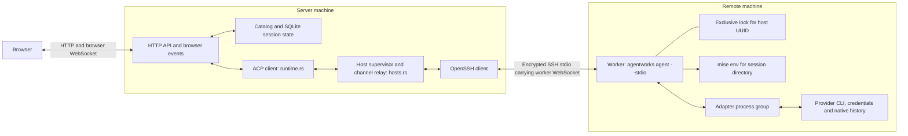
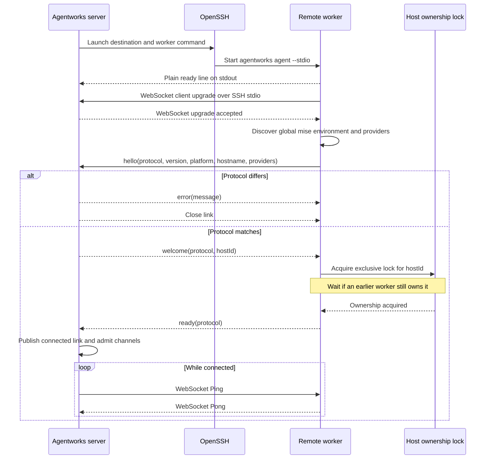
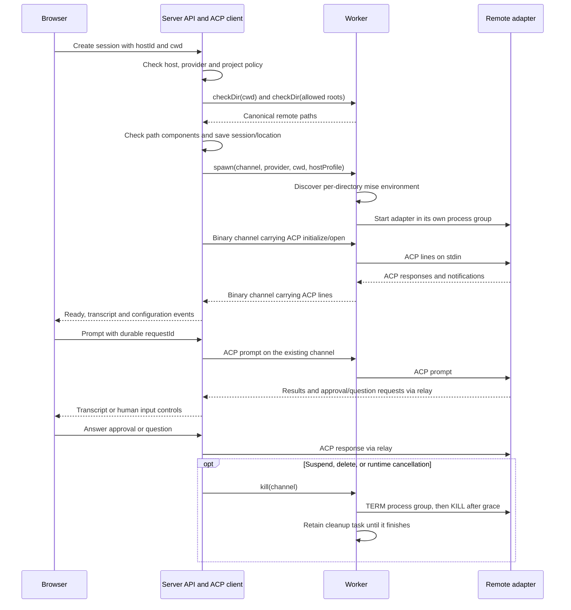
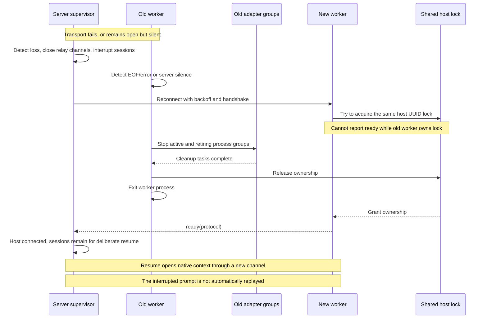
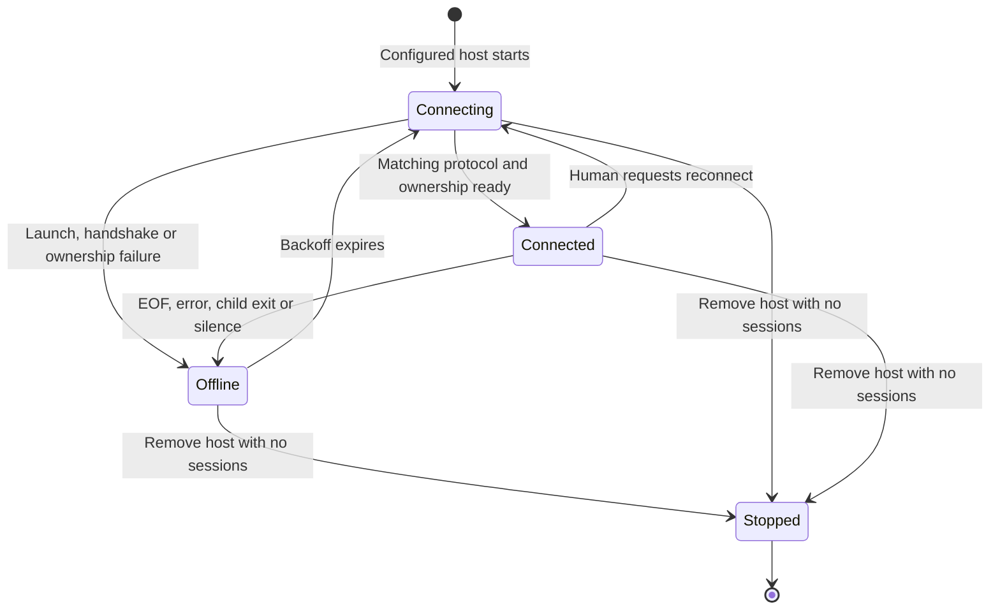

# Remote hosts: implementation and protocol

This describes the implemented **protocol 3** chat-worker link. For setup, see
[remote hosts](OPERATIONS.md#remote-hosts). Planned file/Git views and additional MCP capabilities
are listed in [future work](BACKLOG.md).

## Architecture and ownership



The browser WebSocket and worker WebSocket are separate connections. The server
launches `ssh -T ... -- <destination> '<command> agent --stdio'`. The remote command
is trusted operator configuration. The worker opens no listening port for this
link; `ws://agentworks/worker` is the symbolic WebSocket handshake URI on stdio,
not a DNS lookup or separate network connection.

| Owner | Responsibilities and state |
| --- | --- |
| Server | Host/project/location IDs, allowed host roots, transcripts, approvals/questions, session settings, native session IDs, command admission and browser replay |
| Worker | Per-link channel IDs, adapter subprocess supervision, environment discovery, directory checks and ACP line forwarding |
| Remote provider | Credentials, provider-native conversation storage, tool execution and workspace files |
| Kernel lock | Exclusive ownership for a host UUID in the remote user's cache; retained until worker-managed cleanup tasks finish |

The worker stores no conversation state. Its zero-byte lock file remains at
`~/.cache/agentworks/workers/<host-uuid>.lock`; ownership comes from the held file
descriptor, not file contents. The file is not unlinked on exit, which avoids two
workers locking different inodes under the same pathname. Locks for different
host UUIDs are independent. This is coordination between participating workers,
not a sandbox against other processes running as the same user.

## Connection handshake



The plain preamble line is exactly `agentworks worker ready\n`. Startup banners
before it are skipped within a byte limit. The preamble is not the JSON `ready`
message: only the latter confirms exclusive ownership and makes the link usable.
The worker is the WebSocket **client**, although the server initiates SSH.

SSH supplies authentication, host-key verification and encryption. There is no
worker enrollment token or publicly exposed registration route. The same-origin
browser guard protects host configuration mutations. These inherit the existing
application access model; SSH authentication is not browser-user authentication.

## Wire messages

Text WebSocket messages contain one JSON object. Binary messages contain one ACP
line prefixed with its channel ID. Channel and directory-request IDs are scoped
to one live link and are not durable session IDs or prompt idempotency keys.

| Direction | Type | Fields and meaning |
| --- | --- | --- |
| Worker → server | `hello` | `protocol`: integer; `version`: application version string; `platform`, `hostname`: strings; `providers`: provider-name array; `tools`: discovered CLI paths; `workspace`: worker-side worktree support; `worktreeCleanup`: inspection, removal and restore support; `directories`: folder browsing and creation; optional `mcpRelay`: worker-loopback `endpoint` and absolute native facade `command` |
| Server → worker | `welcome` | `protocol`: matching integer; `hostId`: stable catalog UUID used for ownership |
| Worker → server | `ready` | `protocol`: matching integer; worker has acquired ownership |
| Server → worker | `error` | `message`: handshake rejection diagnostic |
| Server → worker | `checkDir` | `request`: request ID; `path`: remote directory, optionally beginning with `~/` |
| Worker → server | `reply` | Same `request`; canonical `path`, workspace `result`, or `error` string |
| Server → worker | `workspace` | `request`, `operation` (`list`, `prepare`, `inspectWorktree`, `removeWorktree`, `restoreWorktree`, `browseDirectories`, `createDirectory`), `cwd`, `roots`; folder operations carry `path`, `hidden` or `name` ([project directories](PROJECT-DIRECTORIES.md)); preparation also includes `workspace` and project `policy`; lifecycle operations carry server-recorded `owned` metadata, with `fingerprint` and `force` for removal |
| Server → worker | `spawn` | `channel`: channel ID; `provider`: one of `demo`, `claude`, `codex`, `opencode`; `cwd`: remote path; `hostProfile`: boolean passed to adapter configuration |
| Server → worker | `kill` | `channel`: stop this adapter's process group |
| Worker → server | `exit` | `channel`; `message`: startup/exit diagnostic; ends that channel |
| Worker → server | `mcpRequest` | Link-scoped positive `request`; `call` contains `token`, `operation`, `arguments` in the existing native facade bridge format |
| Server → worker | `mcpReply` | Same `request`; `result` contains the facade response or structured `error` |
| Both | Binary | Four-byte unsigned channel ID in network byte order, followed by UTF-8 ACP line bytes, without a trailing newline |
| Both | WebSocket control frames | Ping/Pong for liveness; Close for link termination |

For example, a directory check uses:

```json
{"type":"checkDir","request":1,"path":"~/projects/app"}
```

```json
{"type":"reply","request":1,"path":"/home/dev/projects/app"}
```

Binary channel 7 carrying an ACP initialization request has this layout:

```text
00 00 00 07 | {"jsonrpc":"2.0","id":1,"method":"initialize",...}
 channel   |                   ACP line bytes
```

The worker appends a newline when writing a received ACP line to adapter stdin.
It removes terminal CR/LF bytes from adapter stdout lines before framing them.
There is no separate successful `spawn` acknowledgment. The ACP initialization
and session-open exchange establishes harness readiness; startup failure produces
`exit`. The worker chooses the executable using its own adapter configuration;
the server does not send arbitrary executable paths or shell commands in `spawn`.

## Session creation and channel lifecycle



Directory checks execute on the remote machine. Canonical paths are compared by
path components, including canonicalized roots; this rejects sibling-prefix,
traversal and symlink escapes at admission. The server never reads a remote
session's path as a local path. Root restrictions are application policy, not
OS-level confinement of the SSH user or their agents.

Each channel's startup task owns mise discovery, so a slow project environment
does not block other channels or heartbeat handling. Tools and sign-ins come from
the remote host. Node-based adapters still require a matching Agentworks checkout
and dependencies on that host; the binary contains checkout-relative adapter
paths fixed at build time.

A server-side runtime guard owns each channel. Dropping it asks the worker to
kill the adapter. Killed or replaced channels move into a retiring collection;
leaving the active channel map does not release their cleanup ownership. On link
shutdown the worker stops and awaits both active and retiring tasks before
releasing the host lock. Finished tasks are periodically removed.

## Agentworks MCP messaging relay

A worker advertises optional `mcpRelay: {"endpoint":"127.0.0.1:<port>",
"command":"/absolute/path/to/agentworks"}`. The server supplies this native stdio
facade in ACP new/load/resume/fork configuration. Its endpoint is a worker-owned
loopback listener; the facade still runs `agentworks mcp`. Only its small existing
bridge requests cross the authenticated SSH WebSocket. No SSH port forwarding,
public registration route, server filesystem path, or arbitrary network destination
is exposed. The worker loopback port is separate from the stdio worker link.

This slice permits exactly `tools/list`, `list_sessions`, `read_inbox`,
`send_message`, and `acknowledge_message`. Both relay ends reject other operations;
the server filters discovery to the intersection of this list and the caller's
current grants. Coordinator operations and completion tools remain unavailable
through this relay even when granted locally. The bridge format is the boundary:
adding worker-native inbox/send commands would duplicate the server's durable mail,
project scoping, permission and audit logic, and would not configure an MCP client
for the provider. The native MCP facade continues to translate MCP `tools/call`
into an authorized bridge operation.

The server binds the existing session credential and server-loopback bridge address
to that session's active ACP channel. Neither actor identity nor server destination
comes from a worker call. Unknown credentials, other links' credentials, discovery
channels without a session binding, and ended channels fail closed. Channel exit,
runtime guard drop and link close remove bindings. Requests already admitted can
have executed when a channel/link is lost; teardown does not roll back mutations.
The main bridge resolves the credential and checks live grants/project/peer access
on every request, under the same communication lock and audit path as Local.
Project/session roles and explicit grants are unchanged; relay availability grants
no permission. Sending persists mail without waking a peer. Server-authorized inbox
turns remain a separate feature.

The worker admits at most 16 concurrent sockets/calls, each with an 18-second total
read/reply/write deadline and a 64 KiB newline-terminated request limit. The server
admits at most 16 relays per link, bounds bridge replies at 2 MiB and waits at most
15 seconds. Saturation, malformed/oversized replies, socket errors and timeout
fail closed; a lost reply may leave a mutation's outcome uncertain. There is no
automatic retry. Use the original stable `requestId` when deliberately reconciling
or retrying a send. Unknown/late correlation IDs are ignored; pending requests and
worker sockets are discarded on teardown. Reconnect/resume installs fresh facade
configuration and a new runtime credential; no call is replayed.

The capability is additive within protocol 3. An older worker without `mcpRelay`
continues chat with an empty Agentworks MCP configuration. An older server ignores
the capability. Upgrade both binaries and deliberately resume sessions to enable
messaging. The remote OS account, executable and provider remain trusted: this is
an application permission boundary, not isolation between processes of the same
Unix user. Remote provider-specific MCP behavior still needs real-host validation.

## Disconnect, ownership transfer and resume



The worker checks server silence independently; a half-open SSH link is not
assumed to deliver EOF promptly. A replacement is not published as connected
until it confirms ownership. A lock acquisition timeout leaves the host unavailable
rather than permitting a competing worker.

The server's supervisor generation prevents a stopped supervisor from overwriting
its replacement's link state. Closing a live link fails outstanding channels and
directory requests, aborts its writer, and rejects requests made through stale
handles. A recognized host loss marks affected sessions interrupted/suspended.
Other adapter failures can produce an error status. Reconnection alone does not
retry a turn; deliberate resume opens the saved native context through ACP.
Already executed tool side effects are not rolled back.

Worker-mode cleanup returns before the CLI explicitly exits. This avoids waiting
forever for Tokio's uncancellable stdin reader when a peer holds stdin open.
The ordinary server retains its separate graceful-shutdown path.



## Limits and timers

| Mechanism | Current behavior |
| --- | --- |
| SSH flags | Batch mode, no TTY, 20-second SSH connect timeout; SSH keepalive interval 15 seconds, count 3 |
| Worker startup preamble | Server waits up to 45 seconds; at most 64 KiB read before/through ready line |
| Server handshake stages | Separate 50-second deadlines for WebSocket upgrade, `hello`, and ownership `ready` |
| Worker welcome | Wait up to 10 seconds after sending `hello` |
| Ownership acquisition | Retry file locking every 100 ms, with a 50-second wait bound |
| Server heartbeat | Ping every 15 seconds; checks for more than 45 seconds of silence on ping ticks, so detection can take approximately 60 seconds |
| Worker heartbeat | Check every second for more than 45 seconds without a server frame, then begin cleanup |
| Reconnect | Exponential delay from 2 to 60 seconds; reset after an attempt lasts more than 60 seconds |
| Worktree RPC | 120-second reply wait for bounded Git checks and process-group shutdown; uncertain mutations are not automatically replayed |
| Directory RPC | 15-second reply wait; enclosing session-creation directory validation has a 12-second overall deadline |
| mise discovery | Up to 20 seconds per attempt, with project/global fallback; cancellation kills the mise child |
| Adapter stop | Send TERM to the process group, wait 2 seconds, send KILL before reaping its leader |
| Final adapter output | Up to 1 second to drain stdout after child termination |
| WebSocket limits | 64 MiB maximum incoming message and frame size |
| Queues | Link writers: 256 messages; server ACP outgoing line queue: 64; worker input and server incoming per-channel queues are unbounded |

Timers are detection and cleanup bounds under a responsive runtime/OS, not exact
wall-clock delivery guarantees. Process groups and kernel locks are not containment
for descendants that detach, forcibly killed workers, host failure or filesystems
without suitable locking semantics. Sustained output/load stress has not been
validated; the frame limit does not imply a total memory bound.

## Compatibility and upgrade contract

The wire protocol number is an exact compatibility epoch, independent of the
application `version` reported in `hello`. Both ends require `protocol == 3`;
the server sends an update diagnostic on a mismatch. The application version is
informational and does not select a protocol. Native ACP initialization has its
own protocol/capability exchange inside each relayed channel.

Extra JSON fields are generally ignored. Unknown text message types and malformed
control JSON are generally ignored after handshake; some missing fields default
to empty/zero values. There is no formal strict message schema, version-range or
minor-version negotiation, general feature-capability negotiation, or structured
unsupported-operation response. The provider array advertises installed provider
names. The optional `workspace: true` hello field gates worktree requests; for older
workers, the server rejects worktree requests with an update diagnostic.
The optional `tools` map reports native CLI paths, including bundled Codex/Claude
CLIs. `worktreeCleanup: true` gates inspection, removal and restore on workers that
support the full lifecycle. `directories: true` gates `browseDirectories` and
`createDirectory`; older workers get an update diagnostic. An unrecognized request can time out.

Protocol 2 is intentionally rejected because it does not establish the protocol-3
ownership-ready contract. Upgrade both binaries within a coordinated maintenance
window, reconnect, and deliberately resume interrupted sessions. This protocol
does not promise mixed-version rolling upgrades or cross-link command replay.

Future evolution should preserve existing field meanings within an epoch, use
explicit capabilities before depending on new operations, return correlated
unsupported-operation errors, and add tests for each supported version pair.
Those are recommendations, not currently implemented negotiation behavior.

## Supported scope and verification

Remote sessions currently support chat, configuration exposed through the active
ACP session, approvals/questions, transcript replay, suspend/delete, and native
resume where the provider supports it. Model discovery uses a temporary remote ACP channel without sending a prompt.
Worktree listing, creation and selection run on the worker using the same Git/path
validation as local worktrees, restricted to canonical host roots. Project workspace
policy applies. Archive cleanup, dirty-change confirmation, explicit later removal and
restore on unarchive use the same filesystem implementation as Local. The server
checks session activity and sharing within the owning host; the worker waits for
retiring adapter process groups and rechecks ownership, locks and the confirmation
fingerprint immediately before removal. Branches are retained. Deleting a session
keeps its checkout, as on Local. Pending Git operations
finish before the worker releases host ownership after a disconnect; lost mutation
replies are not automatically replayed.

Queue storage/dispatch, history imports, forks, manual automations, quota continuation
and inbox delivery are server-owned and use the existing ACP relay. Every dispatch
revalidates the host’s current roots and provider availability. Import identities are
scoped by host/provider/profile and verified against the provider-reported original
cwd. Native forks stay within one host/provider; cross-host/provider forks use a
fresh session with recorded transcript/summary context. Link loss pauses queues and
revokes inbox authorization; resuming a session alone does not drain its queue.
Quota timers may resume an authorized saved native context once the host is available,
but claimed/uncertain requests are never automatically replayed. Reset evidence comes
from ACP or a human-selected time; local Codex probes are never run for remote errors.
Inbox context is injected by the server. Remote agents can independently discover peers,
read/send and acknowledge messages through the MCP relay described above; coordinator
MCP tools remain outside this bounded slice.

File/Git views, additional Agentworks MCP operations, remote account/quota probes and
explicit remote API-key mode remain unavailable. See the roadmap for remaining enrichment.

Implementation entry points:

- [crates/agentworks-runtime/src/remote.rs](../crates/agentworks-runtime/src/remote.rs): SSH supervisor, handshake, link registry and channel relay.
- [crates/agentworks-runtime/src/mcp_relay.rs](../crates/agentworks-runtime/src/mcp_relay.rs): bounded worker loopback facade bridge and allowlisted server forwarding.
- [crates/agentworks-runtime/src/worker.rs](../crates/agentworks-runtime/src/worker.rs): worker handshake/lock, heartbeat, adapter groups, environment and directory operations.
- [crates/agentworks-runtime/src/acp.rs](../crates/agentworks-runtime/src/acp.rs): shared ACP negotiation and model/history discovery.
- [crates/agentworks/src/session_runtime.rs](../crates/agentworks/src/session_runtime.rs): local/remote transport selection and session prompt coordination.
- [crates/agentworks/src/hosts.rs](../crates/agentworks/src/hosts.rs): host HTTP API and session/workspace coordination.
- [crates/agentworks/src/main.rs](../crates/agentworks/src/main.rs): host routes, session admission/resume and local-path guards.
- [crates/agentworks/src/catalog.rs](../crates/agentworks/src/catalog.rs): durable host and host-local location configuration.
- [crates/agentworks/src/mcp.rs](../crates/agentworks/src/mcp.rs): native Agentworks MCP facade, local/remote configuration and authoritative permission dispatcher.

After a locked build, `npm run test:remote-hosts` checks the API/relay through an
SSH stand-in, including paths, two hosts, slow mise, approvals/questions,
suspend/resume and reconnect. `npm run test:remote-partitions` checks a silent
open transport, exclusive replacement, adapter teardown, process exit, and a
`kill` immediately followed by disconnect. Both run in `npm run verify`. `npm run test:remote-worktree-cleanup` runs the same
archive/restore safety and browser suite as Local through the worker relay, including
confirmation changes, shared/locked/detached/running checkouts and occupied restore paths;
both local and remote variants also run in `npm run verify`.
`npm run test:remote-plumbing` exercises server-owned workflows through the relay
with remote directories outside the server’s allowed roots: queue dispatch and pause,
imports and host-scoped history IDs, forks, automation idempotency, quota resets,
inbox turns, disconnects and restart. It also runs in `npm run verify`.
Rust tests cover protocol rejection, bounded preambles, request cancellation,
closed handles and ownership locking. [tests/hosts.spec.mjs](../tests/hosts.spec.mjs)
covers desktop/mobile controls and remote/local policy behavior. These checks do
not replace fresh real-SSH and provider-specific validation in the deployment
environment; current end-to-end fixtures use the demo agent and no paid inference.

`npm run test:remote-mcp` exercises real native stdio MCP launched by the demo adapter
on two SSH-stand-in workers, with remote paths outside the server's roots. It checks
peer discovery, remote/remote and remote/local mail, acknowledgments, default roles,
off access, live revocation, spoof/cross-project denial, mutation retries/conflicts,
coordinator method exclusion, and deliberate reconnect/native resume. It also runs
in `npm run verify`. Runtime unit tests cover credential/channel/link binding,
malformed and truncated frames/replies, method/destination restrictions, discovery
filtering, lost replies/timeouts without replay, correlation and teardown cleanup.

## Dashboard host metrics

Workers may negotiate `hostMetrics: 1` in hello. The server then uses
`metricsStart` (also lease renewal), `metricsStop`, and `metricsEvent` over the
existing connection, sharing one collector across dashboard viewers. Older workers
receive no unknown metrics messages. See [host usage](dashboard-host-usage.md) for
message shapes, platform scope, mount policy, expiry, and sample freshness.
